# ShapeShifter

A 2D pixel-art endless runner built with Unity where you survive by changing shape. Run as a
fox, a bird, a stone golem or a fish: each form is the only way past one kind of obstacle, a
short cooldown follows every shift, and the track keeps getting faster.

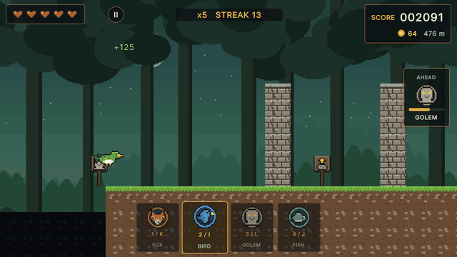

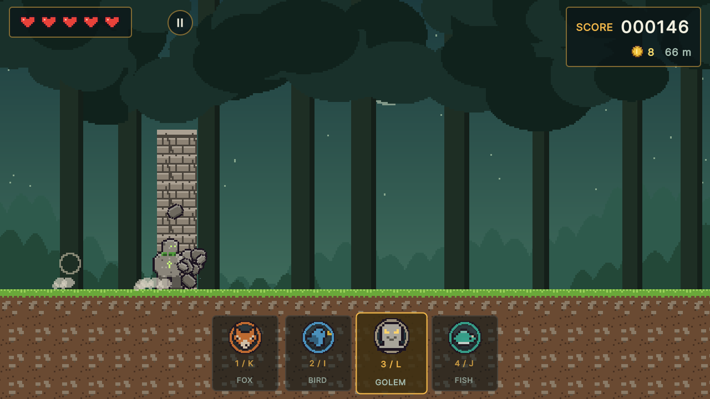

| | |
|---|---|
| 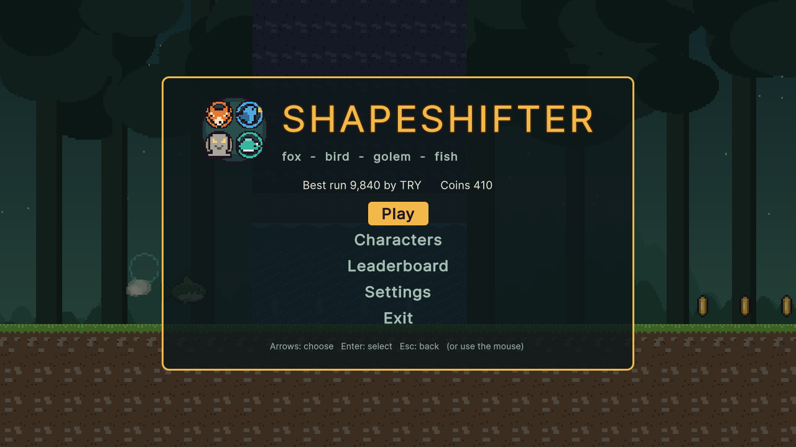 | 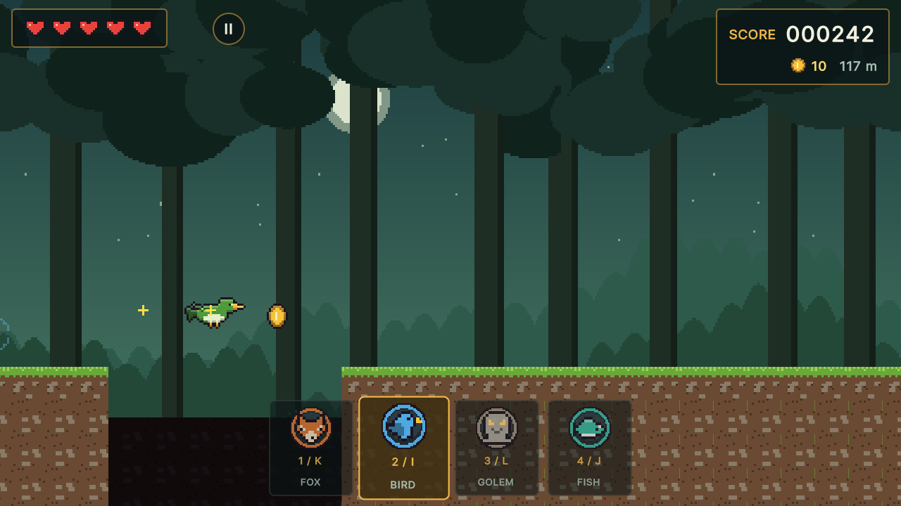 |
| 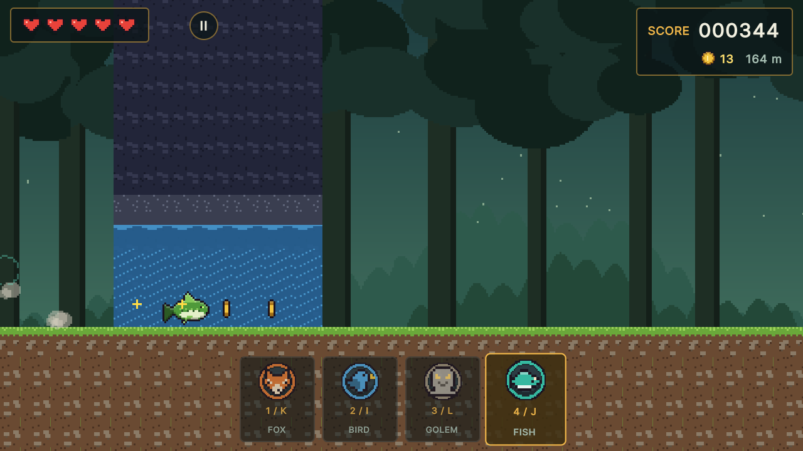 | 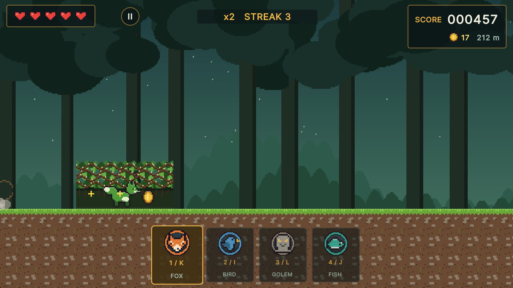 |
| 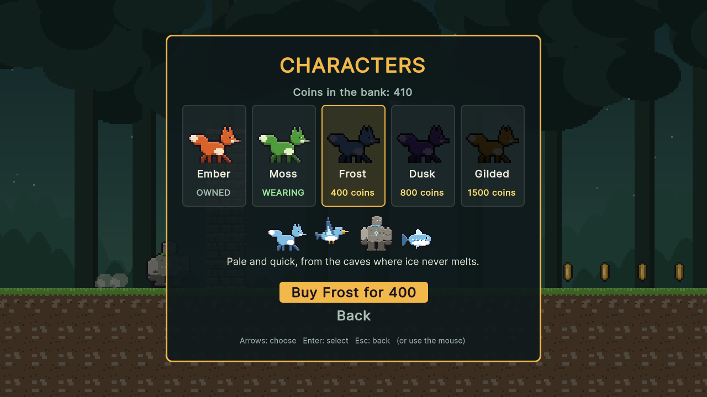 | 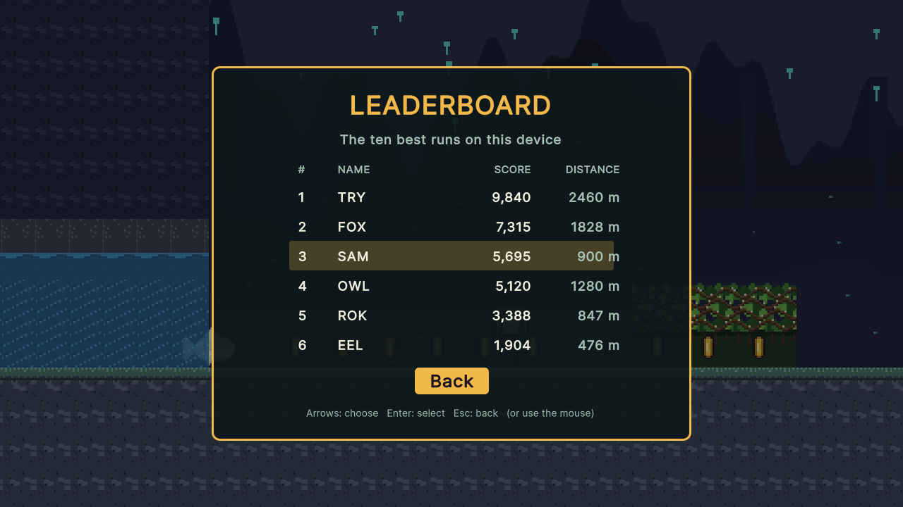 |
| 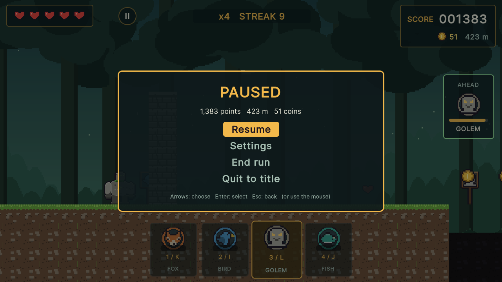 | 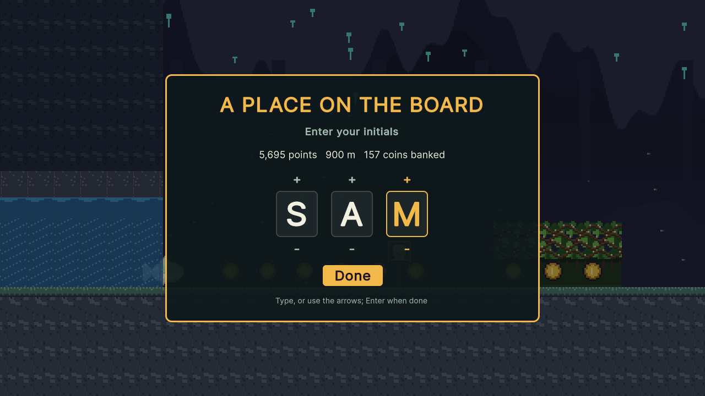 |

## Play it

- **In your browser:** [trysac.github.io/ShapeShifter](https://trysac.github.io/ShapeShifter/)
  (published from the WebGL build of this repository)
- **On itch.io:** [trysac.itch.io/shapeshifter](https://trysac.itch.io/shapeshifter)
- **Get the code:** fork this repository, or clone it:

  ```bash
  git clone https://github.com/Trysac/ShapeShifter.git
  ```

## Run it

1. Install **Unity 6000.3.27f1 (Unity 6 LTS)** with Unity Hub (add the Windows or Web build
   support module if you want to build players).
2. In Unity Hub choose **Add → Add project from disk** and select the repository folder.
3. Open `Assets/Scenes/ShapeShifter.unity` and press **Play**.

To build a player use **File → Build Profiles** (Windows or Web), or build from a terminal into
a folder outside the repository:

```bash
Unity -batchmode -quit -projectPath . -executeMethod ShapeShifter.EditorTools.ProjectBuilder.BuildWebGL -buildOutput ../build/web
```

(`BuildWindows` works the same way.) The WebGL build is uncompressed with a 1280x720 canvas,
so it runs from any static host such as GitHub Pages or an itch.io embed.

The tests run from **Window → General → Test Runner** (EditMode and PlayMode), or from a terminal:

```bash
Unity -batchmode -projectPath . -runTests -testPlatform EditMode -testResults editmode.xml
Unity -batchmode -projectPath . -runTests -testPlatform PlayMode -testResults playmode.xml
```

The README screenshots come from an opt-in hook: run a built player with
`-screenshot <folder>` (optionally
`-scenario title,golem,bird,fish,fox,characters,pause,nameentry,leaderboard,gameover`), or,
without a player,
`Unity -batchmode -projectPath . -executeMethod ShapeShifter.EditorTools.ProjectBuilder.CaptureScreenshots -screenshot <folder>`.

All art and audio are generated. To change them, edit and rerun the generators (Python 3
standard library; the audio script also needs `ffmpeg` on the PATH), then let Unity pick up
the files:

```bash
python tools/art/build.py
python tools/audio/build.py
Unity -batchmode -quit -projectPath . -executeMethod ShapeShifter.EditorTools.ProjectBuilder.SetUpProject
```

## Controls

| Action | Keyboard | Gamepad | Mouse / touch |
|---|---|---|---|
| Fox (slips through thickets) | 1 or K | A | Tap the fox at the bottom |
| Bird (glides over chasms) | 2 or I | Y | Tap the bird |
| Golem (smashes walls and boulders) | 3 or L | B | Tap the golem |
| Fish (swims flooded tunnels) | 4 or J | X | Tap the fish |
| Jump (over boulders) | Space, W or Up | Bumpers, triggers, d-pad or stick up | Tap the screen, or the JUMP button |
| Pause | Esc or P | Start | The pause button |
| Menus | Arrows, Enter, Esc | D-pad, A, B | Click or tap |

The keys K, I, L and J sit in the same diamond as the pad's A, Y, B and X. On-screen touch
buttons appear on touch screens, or always or never, as chosen in Settings.

## How it plays

- **Four forms, four obstacles.** Thickets of thorny branches let only the small fox through;
  chasms are too wide to jump, so only the bird crosses them; stone walls fall only to the
  golem; flooded tunnels, water to the roof, are for the fish. Boulders can be jumped by any
  form (the golem cannot jump, but smashes them). Shifting is instant, then the next shift waits
  0.35 seconds, so a late or wrong choice cannot be fixed in a hurry.
- **Readable warnings.** A wooden sign with the needed form stands well ahead of every
  obstacle, and a panel on the right shows the next one with a countdown bar that turns green
  once you are in the right form. The first wall, chasm, flood and thicket each come with a
  banner that names the form and its key.
- **Hearts and score.** Five hearts, as in the 2021 game; the wrong form costs one, and a
  short blink of invulnerability follows. A chasm drops any form but the bird and carries it
  across, hurt. Score is metres run plus 10 per coin plus a bonus for every obstacle passed
  cleanly, multiplied by a streak (x2 after three clean passes, up to x5); a hit that costs a heart breaks it.
- **Speed.** From 7 to almost 16 units a second, rising steadily over the first kilometres;
  the track alternates between forest and cavern every 600 metres.
- **Coins and characters.** Coins sit along the line each form travels (high over chasms
  for the bird, inside floods for the fish, in an arc over boulders for a jump). They are
  banked at the end of a run and buy skins on the Characters screen: Ember (free), Moss, Frost,
  Dusk and Gilded, each recolouring all four forms.
- **Leaderboard and settings.** The ten best runs are kept on the device with three-letter
  initials, distance and score. Settings hold music and effects volume, screen shake and the
  touch buttons, and list the controls. Progress and settings are saved with PlayerPrefs.

## What I learned / technically interesting

- **Fair procedural generation, proven by a bot.** The track is built in chunks from a
  SplitMix64 generator seeded by the run seed and the chunk index, so a seed always gives the
  same track however far ahead it is asked for (a test builds it in one go and in small steps
  and compares). Between two obstacles the generator leaves the reaction time plus the shift
  cooldown at the speed reached there, and more around boulders. The strongest test is an
  autopilot that reads only the next obstacle, shifts 0.45 s before it and jumps boulders: it
  runs five kilometres on five seeds without a single hit. The same autopilot plays the live
  demo behind the title screen.
- **Rules without the engine.** Forms, cooldown, obstacles, generation, speed, hearts,
  scoring, the wallet and skins, the leaderboard and settings live in `Assets/Scripts/Core`, a
  plain C# assembly with no Unity references, behind a small key-value store interface. 77
  EditMode tests cover them through the public API; 7 PlayMode tests drive the real scene from
  the title through a run, pause, game over, name entry, the leaderboard and buying a skin.
- **A fixed-step simulation.** The rules step at 60 Hz whatever the frame rate, inputs
  between steps are carried to the next one, and pausing stops the simulation instead of
  touching `Time.timeScale`.
- **Everything is generated.** The four forms in five skins, tiles, thickets, walls, floods,
  signs, backdrops and the icon are drawn by `tools/art` with shapes, an outline and rim-light
  pass and ASCII icons; the chiptune music and every effect come from a tiny synthesizer in
  `tools/audio`; the scene, UI panel and player settings come from `ProjectBuilder.cs`. The UI
  is UI Toolkit built in code, and input goes through the Input System.

## Where it came from

ShapeShifter began in April 2021 as a personal Unity project of mine: a pixel-art endless
runner with a title menu (Play, Exit, settings, Leaderboard and an empty Characters screen),
five hearts, a score and coins over cave-and-forest terrain. Two test builds went up to a draft
itch.io page, but the source was never pushed and is lost. This is a rebuild from scratch
around the idea its name promised: changing shape to pass what lies ahead. The 2021 tileset
and hero were of unknown origin, so none of them are used here.

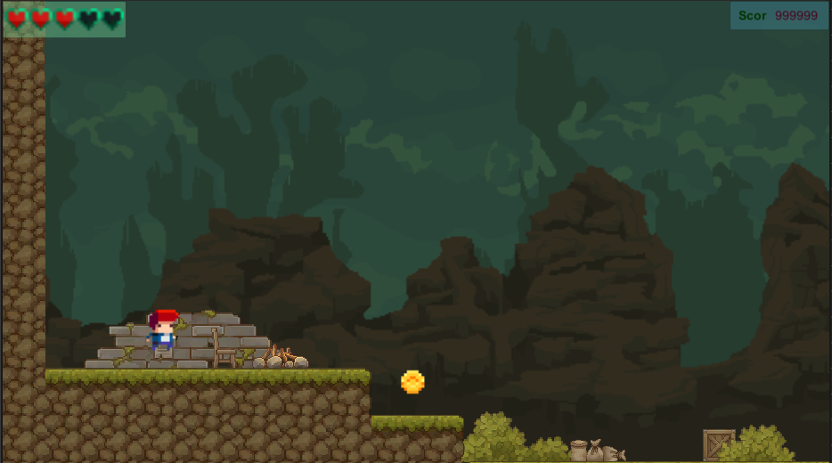

## Credits

Everything in the game was made for this project: generated pixel art, synthesized audio and
Unity's default UI font. See [CREDITS.md](CREDITS.md).

## License

[MIT](LICENSE).
